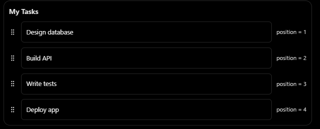
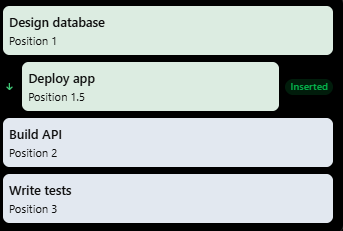
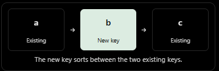

### Fractional Ranking

#### Problem
Cards are sorted by a `position` column.

Dragging **Deploy App** (4) between **Design Database** (1) and **Build API** (2) — how do we save the new order?

#### 1. Integer positions — renumber
| Card            | Old | New |
|-----------------|-----|-----|
| Design Database | 1   | 1   |
| Deploy App      | 4   | 2   |
| Build API       | 2   | 3   |
| Write Tests     | 3   | 4   |

Works, but one drag rewrites many rows → extra writes and contention on large lists.

#### 2. Fractional positions — take the midpoint
New position = $(1 + 2) / 2 = 1.5$

Only the moved card is updated.

**Limitation:** repeated inserts in the same gap halve it each time ($1.5, 1.25, 1.125, \dots$). Floats eventually run out of precision.

#### 3. String keys — extend instead of renumber
Store sortable strings, e.g. `a`, `c`, `e`. Inserting between `a` and `c` gives `b`:

No gap left (`a` and `b`)? Add a character: `aV` sorts between them. Keys grow in length as needed, so you never renumber.

Rocicorp's `fractional-indexing` package implements this: it generates keys before, after, or between existing keys.
